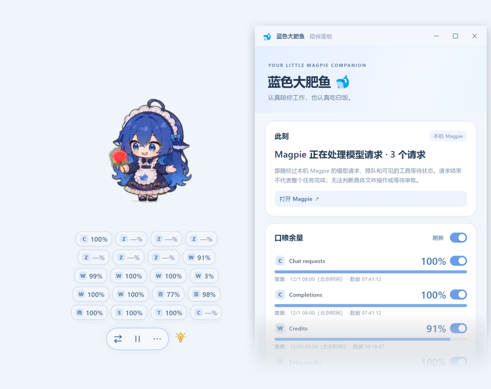

<div align="center">



*截图为 0.1.8 在 Windows 上的实机渲染：左边是桌宠（动画、额度徽章、导航条），右边是面板（标题栏与最小化 / 最大化 / 关闭按钮由 Flutter 自绘），额度数值取自运行机器本机的 Magpie。角色动画来自 [PC2005-cloud/dsh-pet](https://github.com/PC2005-cloud/dsh-pet)。*

# 🐋 magpie-DaFeiYu

### 让 AI 的忙碌，变成桌边的一条鱼。

**Windows · macOS · 接入 Magpie · 看请求、看额度、会放烟花**


[下载 App](https://github.com/wolfvoid/magpie-DaFeiYu/releases/latest) · [功能](#为什么是它) · [安装](#安装) · [致谢](#致谢与许可)

</div>

一只住在桌边的蓝色大肥鱼——Windows 和 Mac 都住得下。请求进来时亮起小灯泡，额度快用完时直接摆在眼前，空闲时吃饭、施法、放烟花——**让 Magpie 的状态不用再开面板确认。**

不需要 DSH，也不绑定 Codex。只要请求经过本机 Magpie，桌宠就能跟着忙起来。

从 0.1.8 起，界面由 Electron 重写为 Flutter：两个平台继续共用同一份 Dart 代码，动画与透明窗口交给 Flutter 引擎绘制，最小化 / 最大化 / 关闭按钮也由应用自己画，不再借用系统标题栏。

> **Magpie 插件说明 · About the Magpie plugin**
>
> - Magpie 里的插件页（npm 包 `magpie-dafeiyu`）只是使用指南入口。桌宠是需要另外下载的独立 App，安装插件不会安装、下载或启动它。
> - 角色与动画素材来自 [PC2005-cloud/dsh-pet](https://github.com/PC2005-cloud/dsh-pet)，遵循其非商用要求。
> - The page in Magpie (npm package `magpie-dafeiyu`) is only a guide. The pet is a separate app you download yourself; installing the plugin does not install, download or start it.
> - The character and animations come from [PC2005-cloud/dsh-pet](https://github.com/PC2005-cloud/dsh-pet) and are for non-commercial use only.

## 为什么是它

| 抓点 | 实际体验 |
| --- | --- |
| 💡 **几个请求，就亮几盏** | 进行中和排队的请求各有灯泡；没有请求时自动熄灭，断连变淡，不冒充“任务完成”。 |
| 💰 **两种额度，两套读法** | 订阅账号显示剩余百分比；DeepSeek 等 API 钱包直接显示剩余金额，不再假装有百分比。 |
| 👥 **额度逐条可控** | 每个额度窗口可单独决定是否显示在桌宠上；徽章带供应商 logo，并在数量较多时自动换行。 |
| 🎬 **93 段动作，不只会待机** | 吃饭、玩耍、魔术、施法、烟花都有；避开最近 15 个动作，降低重复感。 |
| 🖐 **真的能放在桌边** | 可拖动、甩动弹跳、贴边摆放；允许动作越出屏幕，不再被透明窗口卡在中间。 |
| 🪟 **窗口按钮自己画** | 面板标题栏与最小化 / 最大化 / 关闭按钮都是应用内控件，配色跟着角色走，换主题不用迁就系统。 |
| 🔒 **只看本机，不碰聊天** | 只读 Magpie 的本地状态；不调用模型、不读 Codex 数据库、不保存账号邮箱或提示词。 |

底栏只有三件事：**换动作、暂停/继续、更多**。两个平台都默认不开机启动，也不需要登录任何第三方账号。Windows 版解压即用，不写入安装目录。

## 安装

### 直接用 App（推荐）

先选与系统匹配的压缩包：Windows 10+ x64 下载 `magpie-DaFeiYu-v0.1.8-Windows-x64.zip`；Apple Silicon Mac（M 系列，macOS 12+）下载 `magpie-DaFeiYu-v0.1.8-macOS-arm64.zip`。压缩包名称里的系统后缀就是目标平台，请勿混用。

**Windows 10+ x64**

1. 打开 [Releases](https://github.com/wolfvoid/magpie-DaFeiYu/releases/latest)，下载 `magpie-DaFeiYu-v0.1.8-Windows-x64.zip` 并解压到任意文件夹。
2. 双击其中的 `BlueDaFeiYu.exe`。压缩包不含安装器，应用可从任意文件夹直接运行。
3. 启动本机 [Magpie](https://github.com/yetone/magpie)。

Windows 版没有代码签名。若 SmartScreen 拦截，请先核对下载来源，再选择继续运行；不要关闭系统安全防护。

更新时退出桌宠，将新版本解压到新文件夹后运行；删除旧文件夹即可卸载。用户设置保留在应用数据目录中。

**macOS（Apple Silicon）**

1. 打开 [Releases](https://github.com/wolfvoid/magpie-DaFeiYu/releases/latest)，下载 `magpie-DaFeiYu-v0.1.8-macOS-arm64.zip`。
2. 解压后把「蓝色大肥鱼.app」拖进「应用程序」，再从菜单栏打开。
3. 启动本机 [Magpie](https://github.com/yetone/magpie)，请求灯泡和额度会自动接入。

App 使用本地 ad-hoc 签名，没有 Apple Developer ID 签名或公证。若 macOS 拦截，请先核对下载来源，再到「系统设置 → 隐私与安全性」选择「仍要打开」；不要关闭 Gatekeeper。

**要求：Windows 10+ x64，或 Apple Silicon Mac（M 系列），macOS 12+。** 不支持 Intel Mac 或 Linux 桌面；Linux 仅用于 CI 单元测试。

### Magpie 页面

仓库带有 `magpie-plugin` Topic，并提供 Magpie 可识别的页面插件：

```bash
magpie plugin add github:wolfvoid/magpie-DaFeiYu
```

安装后，Magpie 侧边栏会出现「蓝色大肥鱼」使用页。**页面不会自动安装或启动桌面 App**，桌面悬浮窗仍需按上面的说明下载对应系统的 ZIP。页面是纯 HTML + CSS，右上角可切换中文 / EN，默认中文，不加载任何脚本。

## 开发与验证

需要 Flutter 3.50+（Dart 3.14+）与 Git；Windows 需要 Visual Studio 的「使用 C++ 的桌面开发」，macOS 只需要 Xcode（插件全部走 Swift Package Manager，不需要 CocoaPods）。两端命令一致：

```bash
flutter pub get
flutter analyze
flutter test
flutter run -d windows   # macOS 用 -d macos
```

打包：`flutter build windows --release`、`flutter build macos --release`，CI 在两个平台各跑一次。93 段角色的 WebP 动画直接随仓库提供，构建时不需要联网下载素材。

应用图标（`assets/app-icon.png`、`assets/app-icon.ico`、`assets/app-icon.icns`）和托盘图标随仓库提交：Windows 外壳用 `windows/runner/resources/app_icon.ico`，macOS 用 `macos/Runner/Assets.xcassets` 里的 PNG，母版是 `assets/brand/app-icon.png`。换图时用同一份母版手工重新导出这组文件。

冒烟测试先构建调试版再运行：

```powershell
flutter build windows --debug
.\build\windows\x64\runner\Debug\BlueDaFeiYu.exe --smoke-test
```

截图与 `smoke.json` 写入 `DAFEIYU_QA_DIR` 或应用 userData 的 `qa/`，不写入安装目录，也不提交进仓库。

## 语言约定

整个项目最多三种编程语言，分工不重叠：**Dart** 写界面与全部共享逻辑，**Zig** 写需要脱离 Flutter 运行时或跑进 WASM 沙箱的原生能力，**TypeScript** 写工具脚本与桥接示例。除此之外的语言——JavaScript（含 `.cjs` / `.mjs`）、Python、PowerShell、Shell / 批处理、Rust、C#、Kotlin、Ruby、Lua——都不进仓库。

当前主应用是纯 Dart：仓库里没有任何 `.zig` / `.ts` 文件，构建、测试、打包都只需要 `flutter` 一条工具链；Zig 与 TypeScript 是上限，不是配额。插件仓库 `DaFeiYu-Max-Plugins` 正好用这两种语言写插件与工具脚本，与本仓库共同守住三种语言的上限。完整取舍见 [docs/decisions/languages.md](docs/decisions/languages.md)。

`magpie/` 只是静态 HTML + CSS，Magpie 宿主按原样加载、不经过任何构建；这是宿主要求的页面格式，不算第四种源语言。`windows/` 与 `macos/` 里的 C++ / Swift 是 `flutter create` 生成的最小宿主外壳，是唯一允许出现的 C++ / Swift 代码。`test/distribution_test.dart` 以受版本控制的文件为基准扫描：出现第四种语言的扩展名、宿主外壳里塞进 Dart / Zig / TypeScript、Magpie 页面出现脚本、CI 的 Node / Zig 步骤与仓库实际语言不一致，或 `pubspec.yaml` 与 `lib/core/version.dart` 版本不同步，都会失败。

## 一个仓库，两个平台

- 主界面、动画播放、请求灯泡、额度面板、自绘窗口按钮与本地 Magpie 读取共用同一份 `lib/` 代码，Windows 与 macOS 行为一致。
- 平台差异被限制在很窄的范围：应用数据目录、托盘图标（Windows 用 PNG、macOS 用 emoji）、打开 Magpie 的默认路径、打包与签名。Windows 解压即用，macOS 将 App 拖入「应用程序」。
- Magpie 本地配置沿用官方同一路径 `~/.config/magpie/settings.json`（遵循 `XDG_CONFIG_HOME`），Windows 与 macOS 一致，本应用只读取、不修改。
- 不维护平台分支或分叉；改动先在共享代码里实现，确属平台差异的才单独处理。
- 单元测试由 CI 在 Windows、macOS、Linux 三个平台运行；发布产物在 macOS 打包 Apple Silicon，在 Windows 打包 x64。

## 它能知道什么

**它显示 Magpie 能看见的请求，不是完整任务追踪器。**

- 能看见：请求数、排队状态、当前实际使用的账号、Magpie 已缓存的额度。
- 看不见：改了哪个文件、执行了哪条命令、是否等你审批，以及整个任务何时完成。
- 不经过本机 Magpie 的请求不会出现；模型响应结束也不会被误判为任务完成。
- Magpie 暂时断开时保留最近一次有效显示；重置时间已过的旧额度仍会变为 `—%`，不会凭空推算。

本地接口只连接 `127.0.0.1:3425`（支持自定义端口）：并发状态每 2 秒读取，额度和今日统计每 30 秒刷新。Magpie 的配置按官方约定读取 `~/.config/magpie/settings.json`（遵循 `XDG_CONFIG_HOME`），Windows 与 macOS 路径一致。账号归属只在内存中换算为每次启动重新生成的代号。

每次请求都带 `Authorization: Bearer magpie-dafeiyu`，Magpie 的用量统计会把它记为本应用；如果你在 Magpie 里创建了网关 key，可以用环境变量 `MAGPIE_API_KEY` 让桌宠改用它。标出「正在使用」的账号依赖 Magpie 内部的 trace 接口，它以后可能变化；读不到时灯泡照常亮，只是不标红账号。

## 插件现状

0.1.7 及更早的 Electron 版本带过 Zig 脚本插件运行时、插件市场与社交摘要。Flutter 重写尚未迁移这部分能力：面板保留已安装插件的启停与节日装扮，插件市场标注「未开放」，社交摘要标注「未启用」，对应按钮不可点击。仓库也不再附带 Zig SDK、WASM 示例与插件安装脚本，等运行时迁移完成后再一起回来。

## 致谢与许可

| 来源 | 贡献 |
| --- | --- |
| [PC2005-cloud/dsh-pet](https://github.com/PC2005-cloud/dsh-pet) | 大肥鱼形象、动作配置与初始选择器；本项目最重要的视觉来源（上游动画集里只有实际用到的 93 段随包分发）。 |
| [yetone/magpie](https://github.com/yetone/magpie) | 本地模型网关，以及请求、额度、路由接口与集成文档。 |
| [yifanlu0227/DaFeiYu-codex-pet](https://github.com/yifanlu0227/DaFeiYu-codex-pet) | 大肥鱼桌宠与安装思路的最初参考；本项目没有使用其 spritesheet。 |
| [bianbian-666/Codex-dafeiyu](https://github.com/bianbian-666/Codex-dafeiyu) | 早期 Codex 状态联动方案参考；当前版本已改为 Magpie。 |

本仓库新增代码采用 [MIT](LICENSE)；上游选择器保留其 [MIT 许可](licenses/dsh-pet-MIT.txt)。

**角色动画、提示词、源视频等素材不属于 MIT，禁止商用。** 二创展示、介绍和分发必须保留 [PC2005-cloud/dsh-pet](https://github.com/PC2005-cloud/dsh-pet) 来源；完整说明见 [THIRD_PARTY_NOTICES.md](THIRD_PARTY_NOTICES.md)。

这是一个独立社区项目，与 DeepSeek、OpenAI、Magpie 无官方隶属关系。

---

**magpie-DaFeiYu** is a cross-platform desktop pet for Magpie: 93 animations, live request lights, subscription quotas, API wallet balances, and a local-only privacy model. Built with Flutter for Windows 10+ x64 and Apple Silicon macOS 12+.
